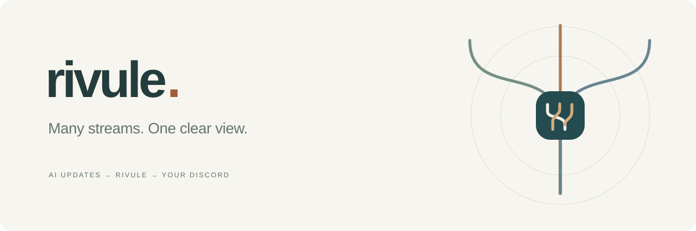

<p align="center"></p>

# Rivule

**让进展汇到一起。**

当前源码版本：**v0.4.4** · [版本说明](docs/RELEASES.md)

v0.4.4 队列诊断与来源展示更新已完成生产部署。2026-10-22，Zot 来源的一条新任务通知已取得 QQ 接口成功回执，并由接收方确认实收；Discord 同次通知返回发送成功。此记录针对该次任务链路，不扩展为其他来源或长期可靠性的验收。其他自托管安装仍需自行更新和验收。

Rivule 是面向个人 AI 助手的自托管通知入口。助手通过 MCP 或 HTTP 上报变化，你在 Discord 看见进展、阻塞和需要决定的事。每条更新保留「助手 → 项目 → 任务 → 分支」的来处，也可配置 QQ 会话内通知。

[开始使用](docs/GETTING_STARTED.zh.md) · [产品展示](docs/showcase/index.html) · [交给 AI 协助](docs/AI_HANDOFF.zh.md)

## 开发中的双向消息桥接（尚未部署验收）

源码新增按 PA 独立管理的「任务更新 / 每次任务回复」及指令回传。PA 必须主动调用 MCP、HTTP 或来源 hook；Discord 的指定消息按钮与 QQ 的明确上下文指令可进入原 PA 的持久队列，由原 PA 领取、按自身权限判断、回报完成或拒绝。排队不代表已执行，也不会唤醒没有相应能力的 PA。

v1 保持真实已登记的 task/run/branch/thread 路径；开发中的 conversation-v2 另有无任务普通会话协议、独立来源操作权限与每渠道所有者授权，不虚构任务字段。QQ 回复另需所有者明确的来源、接收账户和消息类别授权，以及网关独立回查 owner 的固定服务绑定；旧任务通知授权不自动扩展。模板保持关闭，本地离线回归不等于生产送达。管理页面只是控制入口，不是消息桥接的主体。

[来源 hook / API](docs/source-bridge-hook.md) · [Discord 回传](docs/discord-command-adapter.md) · [QQ 回传](docs/integrations/qq-message-commands.md) · [QQ 独立验权](docs/qq-response-authority.md)

## 先接通一个助手

1. 构建源码，由所有者配置 Cloudflare 服务与 Discord bot
2. 让助手通过 MCP OAuth 或 HTTP 完成当前来源的认证
3. 上报一条已获准的连接测试，查询回执，再由接收方确认实收

支持远程 MCP 的助手可通过 OAuth 接入；HTTP 集成按对应鉴权方式配置。每个来源都需完成认证、上报、回执查询与接收方实收确认。助手需要明确上报，Rivule 不会自动读取其他对话。

QQ 支持固定回复、所有者点击的一次性主动验证、会话内持续通知、暂停与容量提示。公开模板默认关闭发送；开启持续通知还需所有者确认当前接收账户与权限。连接时长默认仅提醒，120 分钟是可调整的每日提醒阈值，不会强制暂停；也可自行选择到点暂停。主动通知上限 100 次，最小间隔 3 秒。通知授权只在当前连接会话有效；来源与项目仍须明确允许。当前不提供跨会话自动续权的全天候 QQ 服务，也未覆盖 Discord 的全部功能。

<a id="build"></a>
## 安装与构建

需要 Node.js 24 或更新版本。在源码根目录运行：

```sh
npm ci --ignore-scripts
node scripts/install-font.mjs
node scripts/build.mjs
```

本地检查运行 `npm run check`；离线行为回归运行 `npm test`。当前回归直接加载现行源码，覆盖未知发送结果不自动重试、运行预算默认仅提醒，以及展示页来源筛选。测试不启动 Worker、不联网、不发送通知；不能代替生产实收或浏览器视觉验收。

依赖与字体安装需要网络。构建在 `dist/owner` 和 `dist/gateway` 生成部署模块，不会发布服务或发送通知。接着按[部署指南](docs/OPERATIONS.md)配置自己的账户、来源与目标。

- owner 源码：`src/owner/worker.js`、`src/owner/qq-integration.mjs`
- gateway 源码：`src/gateway/worker.mjs`
- 部署模板：`config/wrangler.owner.example.json`、`config/wrangler.qq.example.json`

首次自托管需要手动配置 Cloudflare 和 Discord，并逐项完成自己的连接与实收检查。

## 文档

- [分步入门](docs/GETTING_STARTED.zh.md)：从构建到第一条实收
- [部署与维护](docs/OPERATIONS.md)：配置、绑定、发送开关与回滚
- [助手接入](docs/INTEGRATIONS.md)：MCP、HTTP、任务快照与回执
- [常见问题](docs/TROUBLESHOOTING.zh.md)：按提示找到下一步
- [安全说明](docs/SECURITY.md)：凭据、数据和读取边界
- [当前能力](docs/CAPABILITIES.md)：渠道支持与使用限制

静态展示使用虚构的示例内容，不连接服务；页面中的通知是示意排版。

从 Git 检出的源码根目录运行 `npm run build:showcase`，即可在 `dist/showcase/` 生成可独立托管的静态展示。不需要安装依赖或字体；文档与许可链接自动指向当前 Git 提交的公开源码页面，页面之间的导航与资源保持本地相对路径。这个命令不部署、不连接实时任务数据、不发送通知。发布前仍需浏览器视觉验收；它不是已上线的任务管理后台。

要在本地浏览展示，从仓库根目录运行 `python3 -m http.server 8080 --bind 127.0.0.1`，然后在自己的浏览器打开 `http://127.0.0.1:8080/docs/showcase/`；需要 Python 3，查看结束按 Ctrl+C 关闭。在 GitHub 中打开 HTML 文件进入的是源码文件页。

## 开源许可

Rivule 采用 [AGPL-3.0](LICENSE)。网络部署应提供与实际运行版本对应的源码入口。第三方依赖与字体保留各自许可，详见[第三方声明](docs/THIRD_PARTY.md)及[源码来源说明](third-party-licenses/COMPILED_SOURCE_AVAILABILITY.md)。

页面中的字母徽章为原创标识，产品名称用于来源识别。
